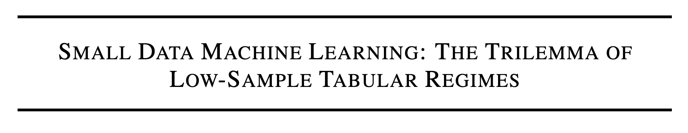
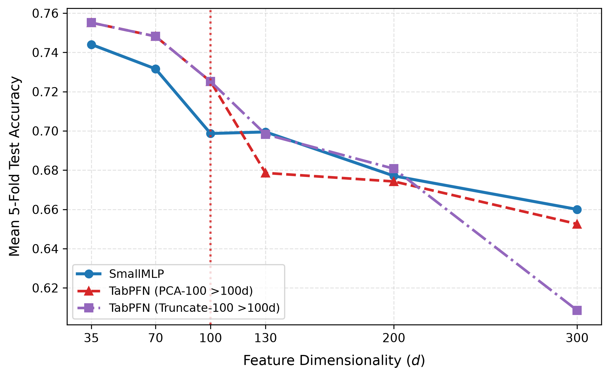
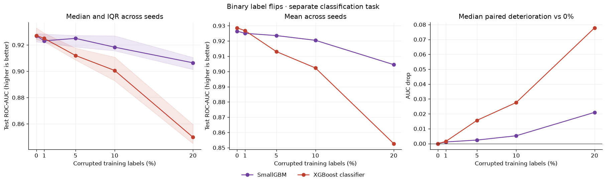
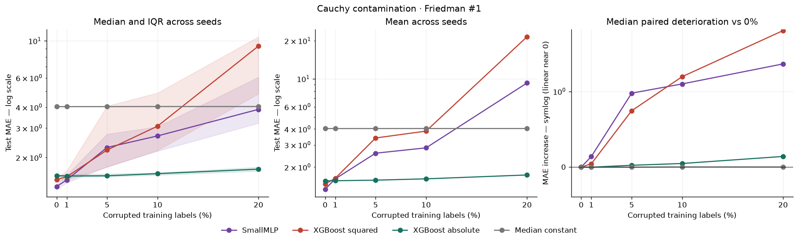

## 📌 Overview

Machine learning on small tabular datasets ($n < 1000$) presents unique mathematical bottlenecks, including severe overfitting, vulnerability to outliers, and the breakdown of standard hyperparameter tuning.

Instead of proposing a universal framework, this paper conceptualizes these fundamental challenges and presents two targeted, pre-tuned algorithmic baselines as case studies:

1. **SmallGBM** (Robust Classification): Utilizes size-adaptive median leaf aggregation to mitigate outlier sensitivity without hyperparameter tuning.
2. **SmallMLP** (Nonlinear Regression & UQ): An adaptive neural network that derives its architecture directly from dataset parameters $(n, d, K)$ and employs locally weighted conformal prediction for calibrated uncertainty.

## 🔬 Key Contributions

1. **The Trilemma of Small Data:** Formalizing why standard algorithms fail without validation tuning (high variance, unbounded influence functions, signal depletion).
2. **Targeted Solutions:** Zero-tuning algorithmic designs that mathematically bound variance and outlier influence.
3. **Strict Performance Boundaries:** Empirical scaling curves demonstrating exactly where standard models (XGBoost, AutoML, TabPFN) overtake our methods.
4. **True Negative Results:** A transparent documentation of what did *not* work (e.g., adaptive depth, PCA-based effective dimensionality) to guide future research.

## 📊 Empirical Highlights

- **TabPFN Dimensionality Wall:** While TabPFN is dominant for $d \le 100$, it suffers catastrophic accuracy collapse when forced to compress higher dimensions. SmallMLP scales gracefully to $d=300$ natively without PCA or truncation.
  
- **Surviving Heavy-Tailed Contamination:** Under 20% Cauchy noise, SmallMLP reduces mean regression MAE by >50% compared to default XGBoost, while maintaining SOTA accuracy on clean data.
- **Robust Classification:** SmallGBM achieves statistical parity with XGBoost on clean data, but limits median AUC degradation to 3.7× less under 20% label corruption.
  
  

## 🔗 Related Repositories & Frameworks

The core implementations discussed in this paper are open-source, alongside the baseline frameworks used for rigorous zero-tuning benchmarking:

**Proposed Methods:**

* 🚀 **[SmallGBM](https://github.com/nsdmlk/SmallGBM)** — Robust Gradient Boosting for $n < 1000$.
* 🧠 **[SmallMLP](https://github.com/nsdmlk/SmallMLP)** — Adaptive Neural Networks with Conformal Intervals.

**Baselines & Evaluated Frameworks:**

* ⚡ **[XGBoost](https://github.com/dmlc/xgboost)** — Scalable Gradient Boosting (default $L_2$ and oracle $L_1$ baselines).
* 🐱 **[LightGBM](https://github.com/microsoft/LightGBM)** — Fast, distributed gradient boosting framework.
* 🌲 **[scikit-learn](https://github.com/scikit-learn/scikit-learn)** — Machine Learning in Python (Random Forests, MLPs, Gaussian Processes, and preprocessing).
* 🤖 **[TabPFN](https://github.com/automl/TabPFN)** — Prior-Data Fitted Networks for in-context tabular classification.
* 📦 **[AutoGluon](https://github.com/autogluon/autogluon)** — Multi-layer stack ensembles for automated machine learning.
* 📊 **[MAPIE](https://github.com/scikit-learn-contrib/MAPIE)** — Conformal prediction framework for uncertainty quantification.

## 🤝 Acknowledgements

This research was conducted independently during undergraduate studies at **Beijing Institute of Technology (BIT)**.

## 📄 License

The text and figures in this repository are licensed under MIT. The referenced code (SmallGBM, SmallMLP) is licensed under MIT.
